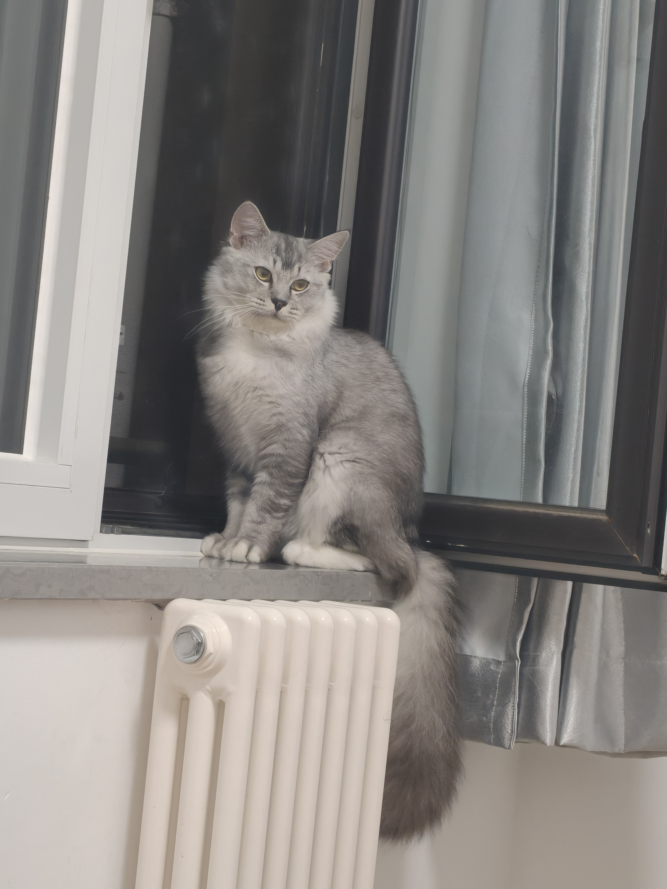
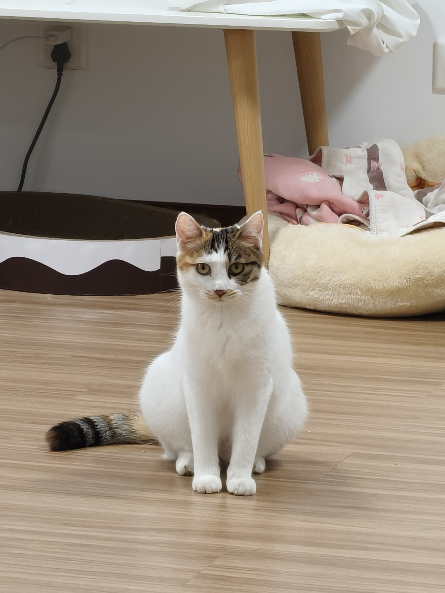

# 案例：薯片和羊羊

这是一份从参考照片到角色差异的案例，不是通用参数。实际运行实现位于仓库 `src/cat*.js`，具体过程见根目录 `REUSABLE-CAT-MODELING.md`。

| 观察项 | 薯片 | 羊羊 |
| --- | --- | --- |
| 参考照片 | `public/seed/photo-01.jpg` 至 `photo-06.jpg` | `photo-07.jpg` 至 `photo-12.jpg` |
| 主色 | 银灰虎斑 | 大面积白色、橘黑花斑 |
| 脸部特征 | 额头虎斑、饱满脸颊 | 不对称面斑、白色鼻梁 |
| 鼻头 | 深灰调 | 粉色 |
| 毛流 | 较长胸毛和蓬松尾毛 | 身体较短的贴合毛流 |
| 制作手段 | 局部形体、花色遮罩、区域毛长 | 同一基础资产，另设花色和毛流 |

## 可借鉴与不可照搬

可以复用：先形体后材质、身体和毛发共享色区、骨骼独立复制、足端控制、后腿与尾部权重检查。

不可直接照搬：基础模型中的 `Object_8`、40 个骨骼的名字、眼睛 UV 区域、静止坐标阈值、毛长和步幅。这些数值只对该资产有效。

## 0.2.1 修复经验

后腿粘连和尾巴拉扯不是靠增加面数解决。尾端原本因高度阈值误归到后腿；腿内侧又混有躯干权重。修复区域归属后，调整后踝折叠、膝盖弯曲约束和急转弯落脚范围，最后再检查毛发表现。

当前定制外观在运行时生成，基础 GLB 本身不包含两只猫的完整定制毛发与程序化动作。本案例仍有形体与动作精修空间，不能作为照片级重建的完成证明。
